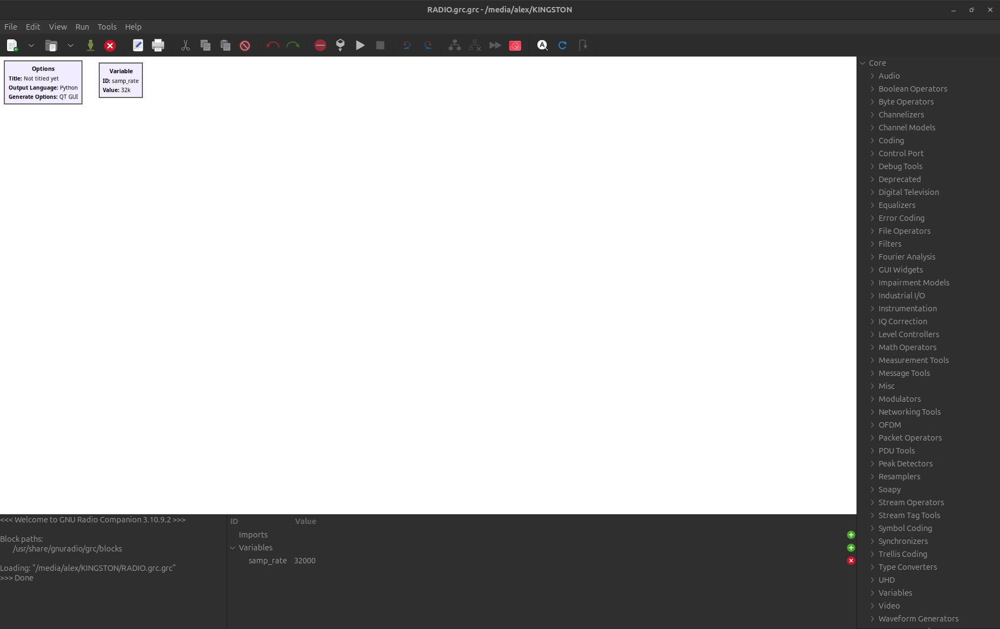

# Отчёт №1 по учебной практике
 
> Студент: Стаценко А.О.    
> Занятие 1 ( 8 сентября )     
> Лекция: Основы структурной схемы цифровой радиосвязи    
> Практика: Архитектура Adalm Pluto SDR. GNU Radio. Построение радио-приёмника

## Цель работы

Познакомиться с устройством ADALM Pluto SDR, освоить основные блоки GNU Radio Companion и изучить построение простого радиоприёмника.

## Краткие теоретические сведения

ADALM Pluto SDR — программно-определяемый радиоприёмопередатчик. Радиочастотная часть принимает и передаёт сигнал, а его дальнейшая обработка выполняется цифровыми средствами.

Основные компоненты устройства:

- **AD9363** — радиочастотный приёмопередатчик с усилителями, фильтрами, АЦП и ЦАП.
- **Zynq SoC** — система с процессором ARM и программируемой логикой FPGA, обеспечивающая управление устройством и обмен цифровыми отсчётами.
- **USB-интерфейс** — связь устройства с компьютером.

При приёме радиосигнал преобразуется в комплексные отсчёты I/Q, поступающие в программу для фильтрации, демодуляции и отображения.

## Ход работы

1. Изучили архитектуру Pluto SDR и назначение приёмного и передающего трактов.
2. Познакомились с интерфейсом GNU Radio Companion: рабочей областью, библиотекой блоков и соединениями между ними.
3. Создали начальный проект с блоками **Options** и **Variable**. Переменная **samp_rate** задаёт частоту дискретизации; в начальном проекте её значение составляло 32 кГц.
4. Рассмотрели построение FM-приёмника по следующей схеме:

**PlutoSDR Source -> Low Pass Filter -> WBFM Receive -> Audio Sink**

Блок **PlutoSDR Source** получает отсчёты от SDR. **Low Pass Filter** выделяет нужную полосу и уменьшает частоту дискретизации. **WBFM Receive** выполняет FM-демодуляцию, а **Audio Sink** выводит звуковой сигнал. Для наблюдения спектра и формы сигнала используются **QT GUI Frequency Sink** и **QT GUI Time Sink**.

*Рисунок - рабочая областью GNU Radio и настройка переменных.*

