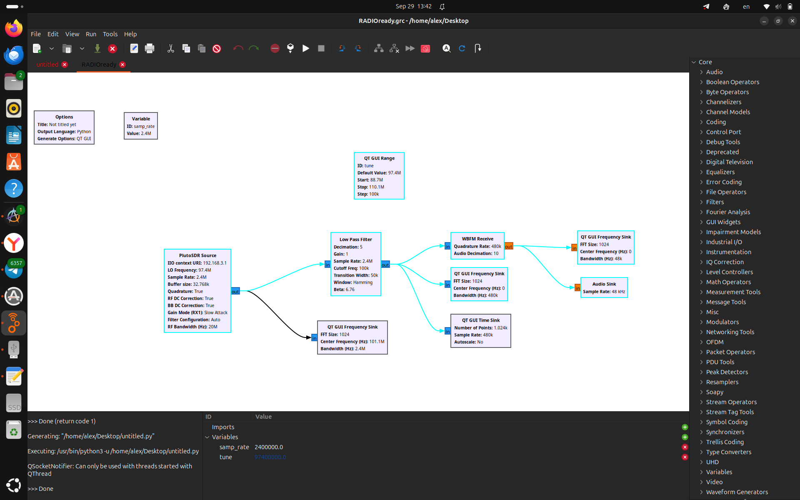
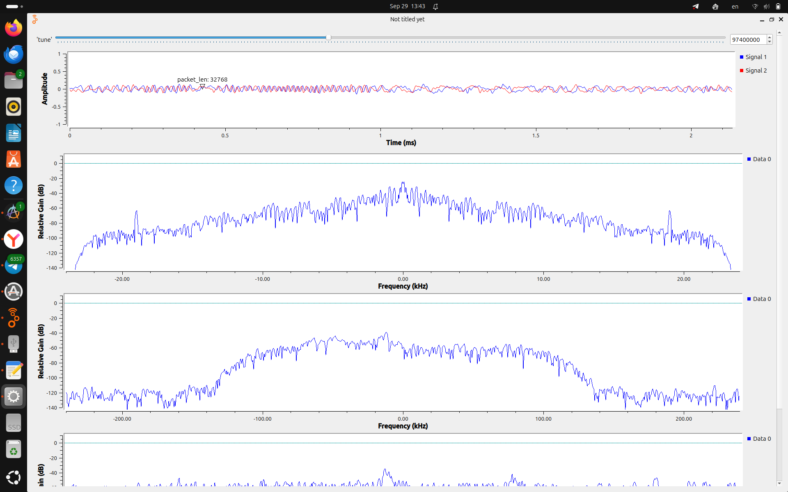
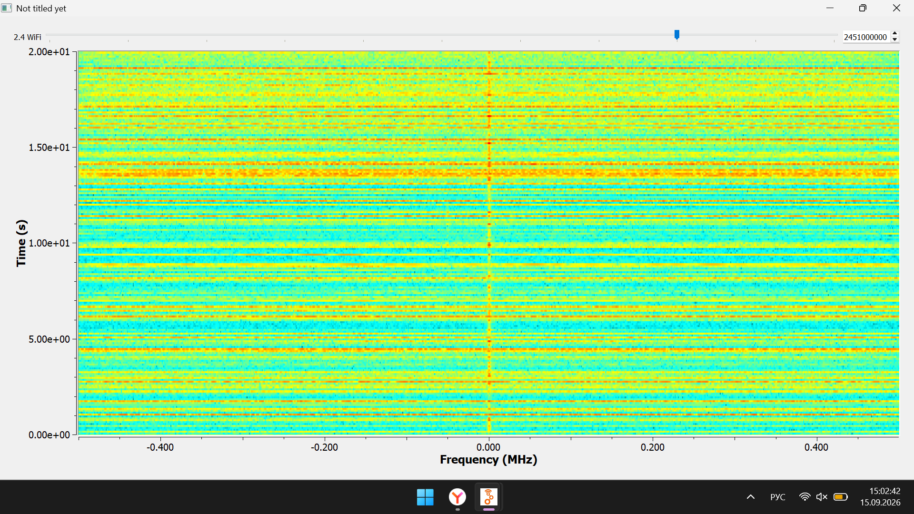

# Отчёт №2 по учебной практике
 
> Студент: Стаценко А.О.    
> Занятие 1 ( 8 сентября )     
> Лекция: Основы структурной схемы цифровой радиосвязи   
> Практика: GNU Radio. Построение радио-приёмника, радио-передатчика.

## Цель работы

Продолжить работу с радиоприёмником, рассмотреть построение передающего тракта и добавить приём и визуализацию сигналов в диапазоне Wi-Fi 2,4 ГГц.

## Ход работы

### 1. FM-радиоприёмник

Продолжили работу со схемой, рассмотренной на первой неделе:

**PlutoSDR Source -> Low Pass Filter -> WBFM Receive -> Audio Sink**

В схему добавлены графики спектра, отображение сигнала во времени и регулятор частоты **QT GUI Range**.

Основные параметры представленной схемы:

| Параметр | Значение |
|---|---|
| Частота настройки | 97,4 МГц |
| Частота дискретизации источника | 2,4 МГц |
| Частота среза фильтра | 100 кГц |
| Полоса перехода фильтра | 50 кГц |
| Децимация фильтра | 5 |
| Частота отсчётов после фильтра | 480 кГц |
| Децимация в WBFM Receive | 10 |
| Частота дискретизации звука | 48 кГц |

После запуска отображаются временной график и спектры на разных этапах обработки. Они позволяют наблюдать принятый сигнал и результат фильтрации.

### 2. Построение радиопередатчика

**Signal Source** формирует сигнал, **Multiply Const** задаёт его амплитуду, а **PlutoSDR Sink** передаёт отсчёты устройству. Для передачи данных или звука перед выходным блоком требуется соответствующий модулятор. При настройке согласуются частоты дискретизации блоков и задаётся несущая частота.

### 3. Построение приёмника для наблюдения диапазона Wi-Fi

Регулятор частоты позволяет менять настройку источника. На скриншоте выбрана частота **~2,4 ГГц**. Водопад показывает изменение спектра во времени: по горизонтали отложено смещение относительно частоты настройки, по вертикали — время, а цветом обозначен уровень сигнала.

Видимая полоса на скриншоте составляет примерно 1 МГц, то есть отображается только участок диапазона. Такая схема позволяет наблюдать активность в диапазоне Wi-Fi, но сама по себе не декодирует пакеты и не создаёт Wi-Fi-сеть. Для полноценного приёмопередатчика Wi-Fi требуются дополнительные блоки обработки кадров и модуляции IEEE 802.11.

