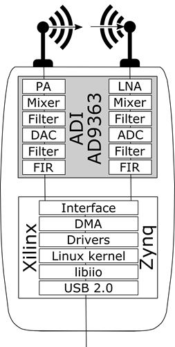
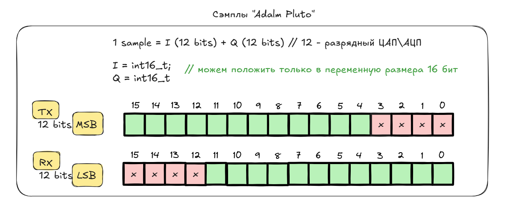
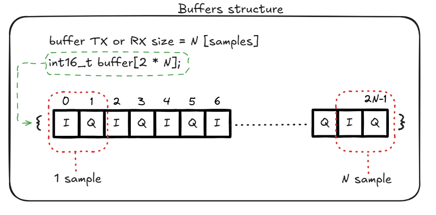

# Отчёт №3 по учебной практике
 
> Студент: Стаценко А.О.    
> Занятие 1 ( 8 сентября )     
> Лекция: Основы структурной схемы цифровой радиосвязи.     
> Практика: Архитектура Adalm Pluto SDR. GNU Radio. Построение радио-приёмника

**План занятия**
- [Теория Adalm Pluto SDR & Timestamp](#adalm-pluto-sdr--timestamp)
- [Установка необходимых библиотек и проектов](#установка-необходимых-библиотек)
- Практические результаты 
---

## Adalm Pluto SDR & Timestamp

**Архитектура**



**Adalm Pluto** имеет два основных компонента — аналоговый радиочастотный приемопередатчик [AD9363](https://www.analog.com/en/products/ad9363.html) и система на кристалле (SoC) [Xilinx Zynq 7000 Series](https://www.xilinx.com/products/silicon-devices/soc/zynq-7000.html).

**AD9363** содержит необходимые усилители, фильтры, а также цифро-аналоговые и аналого-цифровые преобразователи (**12-bit ADC** и **DAC**). Позволяет принимать и предоставлять IQ-сэмплы, формируемые  или принимаемые системой на кристале **Zynq SoC**. Пользователь может настроить  несущую частоту, частоту дискретизации и т.д.

Система на кристале оснащена процессором **ARM Cortex A9**, работающим на частоте **667 МГц** в сочетании с программируемой пользователем вентильной матрицей (**FPGA**). Пользовательские аппаратные модули реализованы в FPGA, обеспечивая связующий слой между прикладными процессорами (**ARM Cortex**) и радиочастотным приемопередатчиком (**AD9363**). Позволяет передавать и получать IQ-сэмплы пользовательскими приложениями, работающими на прикладных процессорах, через драйверы, размещенные в ядре **Linux**.    
Характеристики (Analog Device):
 - RF coverage from 325 MHz to 3.8 GHz
 - Up to 20 MHz of instantaneous bandwidth
 - Flexible rate, 12-bit ADC and DAC
 - One transmitter and one receiver, half or full duplex
 - MATLAB®, Simulink® 
 - supportGNU Radio sink and source blocks
 - libiio, a C, C++, C#, and Python API


---

## Установка необходимых библиотек

**SoapySDR**

``` bash
sudo apt-get install python3-pip python3-setuptools
sudo apt-get install cmake g++ libpython3-dev python3-numpy swig python3-matplotlib

git clone --branch soapy-sdr-0.8.1 https://github.com/TelecomDep/SoapySDR.git

cd SoapySDR
mkdir build && cd build

cmake ../

make -j\`nproc\` # nproc - количество потоков, например make -j16 
sudo make install
sudo ldconfig

```

**Libiio**

``` bash
sudo apt-get install libxml2 libxml2-dev bison flex libcdk5-dev cmake
sudo apt-get install libusb-1.0-0-dev libaio-dev pkg-config 
sudo apt install libavahi-common-dev libavahi-client-dev


git clone --branch v0.24 https://github.com/TelecomDep/libiio.git

cd libiio
mkdir build && cd build
cmake ../
make -j`nproc` # nproc - количество потоков, например make -j16 
sudo make install
```

LibAD9361

``` bash
git clone --branch v0.3 https://github.com/TelecomDep/libad9361-iio.git
cd libad9361-iio

mkdir build && cd build

cmake ../

make -j\`nproc\` # nproc - количество потоков, например make -j16 
sudo make install
sudo ldconfig
```

**SoapyPlutoSDR**

``` bash
git clone --branch sdr_gadget_timestamping https://github.com/TelecomDep/SoapyPlutoSDR.git
cd SoapyPlutoSDR

mkdir build && cd build

cmake ../

make -j\`nproc\` # nproc - количество потоков, например make -j16 
sudo make install
sudo ldconfig
```

## Работа с Adalm Pluto

Создание файла main.c.
``` bash
mkdir dev
cd dev
touch main.cpp
```

**Настройка параметров SDR**    
Используемые библиотеки:
``` C
#include <SoapySDR/Device.h>   // Инициализация устройства
#include <SoapySDR/Formats.h>  // Типы данных, используемых для записи сэмплов
#include <stdio.h>             //printf
#include <stdlib.h>            //free
#include <stdint.h>
#include <complex.h>
```

При работе с SoapySDR инициализация устройства выполняется при помощи указателя на структуру SoapySDRDevice. Аргументы (в рамках библиотеки SoapySDR) имеют формат ключ :  значение :

``` C
SoapySDRKwargs args = {};
SoapySDRKwargs_set(&args, "driver", "plutosdr");        // Говорим какой Тип устройства 
if (1) {
    SoapySDRKwargs_set(&args, "uri", "usb:");           // Способ обмена сэмплами (по USB)
} else {
    SoapySDRKwargs_set(&args, "uri", "ip:192.168.2.1"); // Или (по IP-адресу)
}
SoapySDRKwargs_set(&args, "direct", "1");               // 
SoapySDRKwargs_set(&args, "timestamp_every", "1920");   // Размер буфера + временные метки
SoapySDRKwargs_set(&args, "loopback", "0");             // Используем антенны или нет
SoapySDRDevice *sdr = SoapySDRDevice_make(&args);       // Инициализация
SoapySDRKwargs_clear(&args);
```

Настройка параметров устройств **TX\\RX**:

``` C
int sample_rate = 1e6;
int carrier_freq = 800e6
// Параметры RX части
SoapySDRDevice_setSampleRate(sdr, SOAPY_SDR_RX, 0, sample_rate);
SoapySDRDevice_setFrequency(sdr, SOAPY_SDR_RX, 0, carrier_freq , NULL);

// Параметры TX части
SoapySDRDevice_setSampleRate(sdr, SOAPY_SDR_TX, 0, sample_rate);
SoapySDRDevice_setFrequency(sdr, SOAPY_SDR_TX, 0, carrier_freq , NULL);

// Инициализация количества каналов RX\\TX (в AdalmPluto он один, нулевой)
size_t channels[] = {0}
// Настройки усилителей на RX\\TX
SoapySDRDevice_setGain(sdr, SOAPY_SDR_RX, channels, 10.0); // Чувствительность приемника
SoapySDRDevice_setGain(sdr, SOAPY_SDR_TX, channels, -90.0);// Усиление передатчика
```

Инициализация потоков (stream) для передачи и примема сэмплов:

``` C
size_t channel_count = sizeof(channels) / sizeof(channels[0]);
// Формирование потоков для передачи и приема сэмплов
SoapySDRStream *rxStream = SoapySDRDevice_setupStream(sdr, SOAPY_SDR_RX, SOAPY_SDR_CS16, channels, channel_count, NULL);
SoapySDRStream *txStream = SoapySDRDevice_setupStream(sdr, SOAPY_SDR_TX, SOAPY_SDR_CS16, channels, channel_count, NULL);

SoapySDRDevice_activateStream(sdr, rxStream, 0, 0, 0); //start streaming
SoapySDRDevice_activateStream(sdr, txStream, 0, 0, 0); //start streaming
```

## Сэмплы и буфер

**Сэмплы**

Начнем с описания `сэмпла` в рамках работы с **Adalm Pluto**.



Буфер, его структура

Выделение памяти под буферы (для хранения сэмплов `TX`, `RX`):

``` C
// Получение MTU (Maximum Transmission Unit), в нашем случае - размер буферов. 
size_t rx_mtu = SoapySDRDevice_getStreamMTU(sdr, rxStream);
size_t tx_mtu = SoapySDRDevice_getStreamMTU(sdr, txStream);

// Выделяем память под буферы RX и TX
int16_t tx_buff[2*tx_mtu];
int16_t rx_buffer[2*rx_mtu];
```

Структура буффера



Код с более подробным описанием получения сэмплов с SDR:

``` C
const long  timeoutUs = 400000;
long long last_time = 0;
// Количество итерация чтения из буфера
size_t iteration_count = 10;

// Начинается работа с получением и отправкой сэмплов
for (size_t buffers_read = 0; buffers_read < iteration_count; buffers_read++)
{
    void *rx_buffs[] = {rx_buffer};
    int flags;        // flags set by receive operation
    long long timeNs; //timestamp for receive buffer
    
    // считали буффер RX, записали его в rx_buffer
    int sr = SoapySDRDevice_readStream(sdr, rxStream, rx_buffs, rx_mtu, &flags, &timeNs, timeoutUs);

    // Смотрим на количество считаных сэмплов, времени прихода и разницы во времени с чтением прошлого буфера
    printf("Buffer: %lu - Samples: %i, Flags: %i, Time: %lli, TimeDiff: %lli\n", buffers_read, sr, flags, timeNs, timeNs - last_time);  
}
```

Подготовка массива для передачи (TX buffer):

``` C
  //заполнение tx_buff значениями сэмплов первые 16 бит - I, вторые 16 бит - Q.
    for (int i = 2; i < 2 * tx_mtu; i+=2)
    {
        // ЗДЕСЬ БУДУТ ВАШИ СЭМПЛЫ
        tx_buff[i] = 1500 << 4;   // I
        tx_buff[i+1] = 1500 << 4; // Q
    }
    //prepare fixed bytes in transmit buffer
    //we transmit a pattern of FFFF FFFF [TS_0]00 [TS_1]00 [TS_2]00 [TS_3]00 [TS_4]00 [TS_5]00 [TS_6]00 [TS_7]00 FFFF FFFF
    //that is a flag (FFFF FFFF) followed by the 64 bit timestamp, split into 8 bytes and packed into the lsb of each of the DAC words.
    //DAC samples are left aligned 12-bits, so each byte is left shifted into place
    for(size_t i = 0; i < 2; i++)
    {
        tx_buff[0 + i] = 0xffff;
        // 8 x timestamp words
        tx_buff[10 + i] = 0xffff;
    }

    last_time = timeNs;

    // Переменная для времени отправки сэмплов относительно текущего приема
    long long tx_time = timeNs + (4 * 1000 * 1000); // на 4 \[мс\] в будущее

    // Добавляем время, когда нужно передать блок tx_buff, через tx_time -наносекунд
    for(size_t i = 0; i < 8; i++)
    {
        uint8_t tx_time_byte = (tx_time >> (i * 8)) & 0xff;
        tx_buff[2 + i] = tx_time_byte << 4;
    }

    // Здесь отправляем наш tx_buff массив
    void *tx_buffs[] = {tx_buff};
    if( (buffers_read == 2) ){
        printf("buffers_read: %d\\n", buffers_read);
        flags = SOAPY_SDR_HAS_TIME;
        int st = SoapySDRDevice_writeStream(sdr, txStream, (const void * const*)tx_buffs, tx_mtu, &flags, tx_time, timeoutUs);
        if ((size_t)st != tx_mtu)
        {
            printf("TX Failed: %i\\n", st);
        }
    }
```

Одновременный прием и передача

``` C
const long  timeoutUs = 400000;
long long last_time = 0;
// Количество итерация чтения из буфера
size_t iteration_count = 10;

// Начинается работа с получением и отправкой сэмплов
for (size_t buffers_read = 0; buffers_read < iteration_count; buffers_read++)
{
    void *rx_buffs[] = {rx_buffer};
    int flags;        // flags set by receive operation
    long long timeNs; //timestamp for receive buffer
    
    // считали буффер RX, записали его в rx_buffer
    int sr = SoapySDRDevice_readStream(sdr, rxStream, rx_buffs, rx_mtu, &flags, &timeNs, timeoutUs);

    // Смотрим на количество считаных сэмплов, времени прихода и разницы во времени с чтением прошлого буфера
    printf("Buffer: %lu - Samples: %i, Flags: %i, Time: %lli, TimeDiff: %lli\n", buffers_read, sr, flags, timeNs, timeNs - last_time);
    last_time = timeNs;

    // Переменная для времени отправки сэмплов относительно текущего приема
    long long tx_time = timeNs + (4 * 1000 * 1000); // на 4 [мс] в будущее

    // Добавляем время, когда нужно передать блок tx_buff, через tx_time -наносекунд
    for(size_t i = 0; i < 8; i++)
    {
        uint8_t tx_time_byte = (tx_time >> (i * 8)) & 0xff;
        tx_buff[2 + i] = tx_time_byte << 4;
    }

    // Здесь отправляем наш tx_buff массив
    void *tx_buffs[] = {tx_buff};
    if( (buffers_read == 2) ){
        printf("buffers_read: %d\n", buffers_read);
        flags = SOAPY_SDR_HAS_TIME;
        int st = SoapySDRDevice_writeStream(sdr, txStream, (const void * const*)tx_buffs, tx_mtu, &flags, tx_time, timeoutUs);
        if ((size_t)st != tx_mtu)
        {
            printf("TX Failed: %i\n", st);
        }
    }
    
}
```

Не забываем освободить везде память:
``` C
//stop streaming
SoapySDRDevice_deactivateStream(sdr, rxStream, 0, 0);
SoapySDRDevice_deactivateStream(sdr, txStream, 0, 0);

//shutdown the stream
SoapySDRDevice_closeStream(sdr, rxStream);
SoapySDRDevice_closeStream(sdr, txStream);

//cleanup device handle
SoapySDRDevice_unmake(sdr);

return 0;
```

Для сборки проекта можно воспользоваться системой сборки - `CMake`:

В корне вашего проекта создать файл `CMakeLists.txt`:

``` cmake
cmake_minimum_required(VERSION 3.16)
project(PlutoSDR C)

set(CMAKE_BUILD_TYPE Debug)

# Опция для включения или отключения установки зависимостей
option(INSTALL_DEPS "Установить зависимости" ON)
option(PLUTO_TIMESTAMP "Build pluto with timestamp" ON)

# RF frontend driver
find_package(SoapySDR REQUIRED)

set(MAIN_SOURCE_FILES
    src/main.c
)

# Добавляем исполняемый файл
add_executable(main ${MAIN_SOURCE_FILES})

target_link_libraries(main ${SoapySDR_LIBRARIES})
```

Сборка и компиляция проекта

Стркутура проекта

- [ ] project_name
  - [ ] main.cpp
  - [ ] CMakeLists.txt
  - [ ] build - нужно создать эту папку для хранения файлов сборки


Сборка проекта

``` bash
cd имя_проекта
mkdir build
cd build
cmake ../
make
```

Запуск проекта 

``` bash
sudo ./main
```

Python. Чтение данных .pcm

``` python
import numpy as np
import matplotlib.pyplot as plt

# Открываем файл для чтения
name = "path_to_file/txdata.pcm"

data = []
imag = []
real = []
count = []
counter = 0
with open(name, "rb") as f:
    index = 0
    while (byte := f.read(2)):
        if(index %2 == 0):
            real.append(int.from_bytes(byte, byteorder='little', signed=True))
            counter += 1
            count.append(counter)
        else:
            imag.append(int.from_bytes(byte, byteorder='little', signed=True))
        index += 1
        
# Инициализируем список для хранения данных


# fig, axs = plt.subplots(2, 1, layout='constrained')
plt.figure(1)
# axs[1].plot(count, np.abs(data),  color='grey')  # Используем scatter для диаграммы созвездия
plt.plot(count,(imag),color='red')  # Используем scatter для диаграммы созвездия
plt.plot(count,(real), color='blue')  # Используем scatter для диаграммы созвездия
plt.show()
```